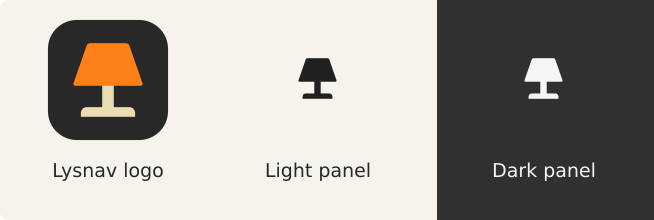
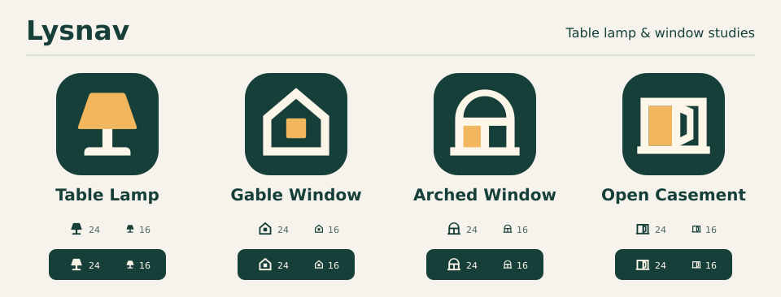

# Lysnav identity

The [Table Lamp logo](../../assets/lysnav-logo.svg) has a `#282828` rounded square, a `#fe8019` shade and a `#ebdbb2` stem and base. Use it for the app identity and About view.

For system panels, use the transparent [light-mode icon](../../assets/tray-light.svg) with a dark lamp or the [dark-mode icon](../../assets/tray-dark.svg) with a light lamp. The tighter crop keeps the silhouette legible at small sizes.

## Earlier table lamp and window studies

The lamp has a visible stem and foot. Gable Window brings the original roof and walls into one continuous outline and centers the pane between them. Arched Window and Open Casement explore how much of the idea survives with just a window frame.

- [Table Lamp](table-lamp.svg) — A tapered shade on a stem and foot.
- [Gable Window](gable-window.svg) — One lit pane centered under a roof.
- [Arched Window](arched-window.svg) — Two panes beneath a rounded arch.
- [Open Casement](open-casement.svg) — A lit pane beside an open sash.

The [one-colour SVG symbols](tray-symbols.svg) use the same four names as the launcher files. The arched and casement symbols keep both panes open so their frames remain visible at 16 pixels.

## First studies

All three proposals use the same deep teal, warm ivory, and amber. The final row shows each mark in one colour at 24 and 16 pixels. The same mark can be used across KDE Plasma, Windows, and a future Android edition.

- [Pendant](pendant.svg) shows a hanging shade and the light below it.
- [Dimmer](dimmer.svg) shows the control itself, with a single pointer.
- [Lit Window](lit-window.svg) places one illuminated window beneath a roof.
