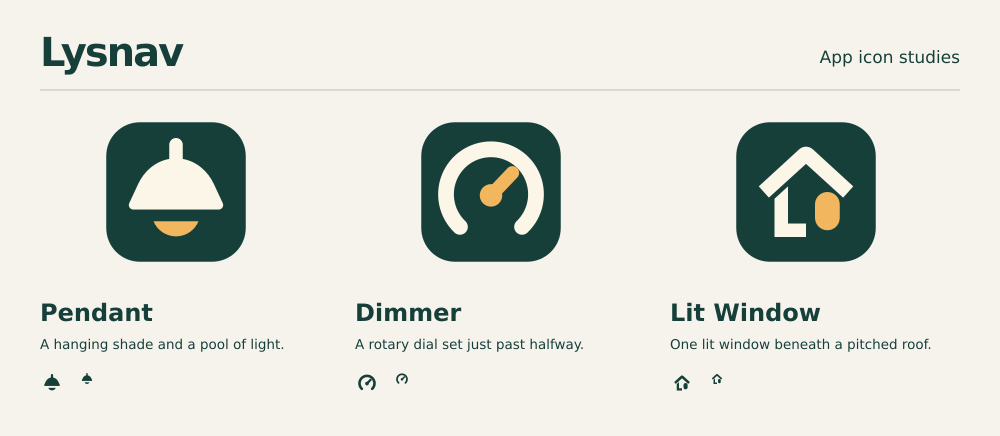

# Lysnav icon studies

All three proposals use the same deep teal, warm ivory, and amber. The final row shows each mark in one colour at 24 and 16 pixels. The same mark can be used across KDE Plasma, Windows, and a future Android edition.

- [Pendant](pendant.svg) shows a hanging shade and the light below it.
- [Dimmer](dimmer.svg) shows the control itself, with a single pointer.
- [Lit Window](lit-window.svg) places one illuminated window beneath a roof.
